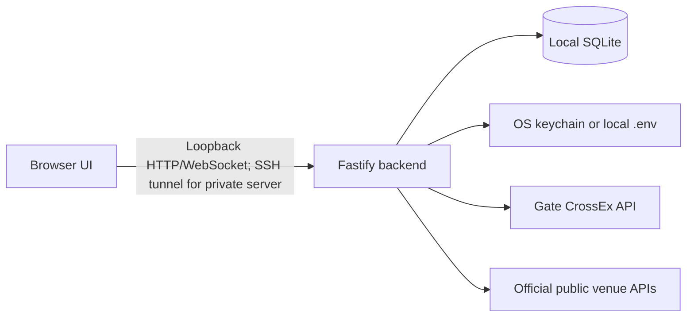

# Architecture

PIXIU ARB is a single-user terminal backed by Gate CrossEx. The owner can run the backend locally or on a dedicated private server reached through an SSH tunnel. It has no central hosted account service, telemetry or maintainer-controlled trading service. `legacy-terminal/` is the sole maintained checkout.

## Components

```text
apps/backend          Fastify API, exchange adapters, strategies, SQLite
apps/frontend         React/Vite user interface
packages/domain       Decimal-safe trading helpers
packages/public-data  Unauthenticated venue-data adapters
packages/shared-types Runtime schemas and shared contracts
migrations            Immutable checksummed SQLite migrations
scripts               Launch, maintenance, test, and release tooling
```



The frontend never connects directly to an exchange and never receives stored credentials. The backend validates local Host/Origin, CSRF tokens, intent headers, and runtime schemas before handling sensitive actions.

## Data and credentials

- SQLite uses foreign keys, WAL journaling, integrity checks, and an owner-only process lock.
- Applied migration filenames and SHA-256 checksums are immutable.
- Financial values remain decimal strings at API boundaries and use decimal-safe arithmetic.
- Credentials live in isolated account profiles in the OS keychain by default or in an explicitly selected, gitignored, owner-only `.env` file. SQLite stores only non-secret profile metadata and the active-profile pointer. Switching profiles locks trading, verifies the target key, clears authenticated account caches, and reconnects the private stream.
- Logs and audit records are bounded and redact credential material and sensitive headers.

### Managed-position persistence

| Table | Responsibility |
| --- | --- |
| `execution_strategies` / `execution_orders` / `execution_fills` | Task configuration and additional-fill/order evidence |
| `managed_positions` | Lifecycle JSON, stable `groupId`, adopted quantities/cost evidence, total-position observations, exit and stop intent |
| `managed_position_claims` | Durable account/contract owner; retained for stopped holdings and released only after flat proof or atomically transferred |
| `managed_risk_lock` | Persisted temporary account recheck or hard manual risk pause |
| `managed_position_reservations` | Migration `0023_managed_adoption.sql`: temporary per-symbol admission lock while the previous owner remains responsible |
| `margin_cost_reservations` | Migration `0029_margin_cost_reservations.sql`: account/batch key, remaining amount and original execution budget/legs; independent of incident JSON, retained until settlement proof |
| `paired_entry_reservations` | Migration `0032_paired_entry_reservations.sql`: approved paired-entry quantities, account funding responsibility and execution progress; persisted across partial fills and restart, never released for an unknown order |
| `margin_risk_accounts` | Saved policy, pinned incident JSON, reduction batch and separate entry latch |
| `margin_risk_samples` / `margin_risk_minutes` / `margin_risk_events` | Account-bound observations, gap/extrema aggregates and versioned action evidence |

Migration `0028_cross_margin_capability.sql` adds nullable `crossex_instruments.support_cross` and `execution_orders.remote_update_time`. Existing instruments remain unknown until refreshed. Remote time is persisted evidence, not a cross-endpoint transaction sequence. Managed JSON additionally retains versioned `marginBatch`, observed reduction totals, settlement waits and external-reduction incidents; batch/order linkage uses the existing `execution_orders.strategy_clip` column.

Migration filenames/checksums are the authority. A reused production database may retain later-named historical migrations; verify the expected ledger entry rather than inferring schema readiness from the lexicographically last filename or a pristine test database's count.

## Market and account state

The backend validates CrossEx REST snapshots and public/private WebSocket pushes before normalizing them for the UI. Detailed market subscriptions are demand-driven and bounded. Official unauthenticated venue APIs supply display statistics and a separate, strictly validated native execution-backup path; display reference prices alone do not grant execution readiness.

The same-upstream CrossEx recovery layer has two paths for the exact symbol: the primary ticker stream and demand-driven recovery sockets subscribing to ticker plus a supported full-book snapshot. `executable-quote.ts` validates snapshot sides and normalizes their best bid/ask; `quote-recovery.ts` permits at most two candidate sockets and eight connection attempts per rolling minute. A healthy leg's socket is retained while another candidate probes a missing leg. An ACK or a healthy connection alone never proves a usable quote. Kraken has no full-snapshot fallback in this implementation.

`native-market-data.ts` separately validates exact native perpetual identity, metadata expiry, source time and quantity units. `quote-source-selector.ts` keeps source-local validity and replay watermarks, selects a qualified native backup when CrossEx is unusable, and requires two advancing qualified CrossEx samples for failback while the native backup remains healthy. `market-hub.ts` uses independent primary-health evidence to schedule bounded probes even while a backup is healthy. `owned-market-demand.ts` preserves sampling for owned risk-paused tasks; stopped/transferred responsibility is not reactivated. Full source mappings and limits are authoritative in [data recovery](data-recovery.md).

The hub retains each CrossEx quote's upstream timestamp, receipt time and socket owner. Disconnects invalidate receipt evidence; older frames cannot roll quotes backward, numerically equivalent values do not conflict, and genuinely conflicting values at the same timestamp remain unavailable until a newer quote. Full books do not refresh last-trade, funding or open-interest provenance. Field meanings and venue channel selection are in [integration](integration.md#executable-quote-provenance).

`funding-overview.ts` publishes each venue as its bounded read completes. Managed funding and full-page statistics have separate refresh/cache paths, with shared per-venue Retry-After and monotonic generation checks. Held-position projections use the refreshed managed cache; unknown periods and expired data cannot enter economic decisions. Quote source health, incident notifications and exit-condition dwell are separate state.

Private account pushes update one account-wide in-memory projection. Periodic REST reconciliation remains the recovery and ledger path; newer stream events are replayed over in-flight snapshots so older responses cannot overwrite them silently.

Trade, Strategy and Portfolio workspaces also request a fresh authenticated portfolio every 30 seconds while they are open. The asset dialog shares the mounted Portfolio view; the former position-management URL is an alias. This bounds visible balance staleness when an external transfer is not delivered by the private stream; the backend retains its independent jittered five-minute REST reconciliation as the recovery path.

CrossEx instrument metadata is cached for five minutes and remains mandatory for strategy sizing. The browser allows the large catalog request up to 45 seconds and retries failed loads every five seconds; strategy launch stays disabled with an explicit loading state until both selected instruments are known.

See [integration boundaries](integration.md) for the external endpoint and channel allowlist.

## Paired execution presentation

`strategy-route.tsx` keeps the existing strategy draft, request construction, validation and final confirmation. Page-scoped `hedge-execution.css` uses the available width without changing global navigation. `hedge-execution-summary.tsx` adds display-only review metrics and the advanced-exit disclosure; its numeric checks reuse the existing management schema and do not replace launch validation. The parent draft retains values across disclosure, reduce-only and monitoring visibility changes. The running strategy panel and shared position table remain on their existing action paths. Responsive rules and all 23 controls are specified in the [hedge execution contract](hedge-execution-configuration.md).

## Read-only performance reporting

The Asset Management workspace preserves the original Portfolio layout and reuses the existing performance and funding APR calculations. One portal host moves the mounted asset view between the full page and the asset dialog, preserving form state and subscriptions. The automation panel is rendered at the bottom of paired-position execution; the old position-management URL redirects to Portfolio. An independent minute sampler stores account-scoped equity, cash-flow evidence and coverage in the additive `0025_account_performance.sql` tables. It never calls the trading runtime or changes risk/permission state. Missing identity, asset/FX coverage, unknown ledger entries and unreconciled transfers prevent financial conclusions. See [performance accounting and API](account-performance.md).

Portfolio and paired execution use the same `PositionsTable`. The liquidation column and scenario controls are removed; optional raw exchange liquidation/margin-mode fields remain in the REST adapter, private projection and DTO without weakening quantity validation. USD valuation uses a fixed, credential-free Kraken public trade source independently of other Gate spot rates; no parity assumption or historical backfill is used. Fee totals remain part of the existing PnL accounting, never a second deduction. Current controls and preserved shared management modules follow the [hedge execution contract](hedge-execution-configuration.md).

Account margin protection uses official account ratios and the existing managed order runtime. The paired reduction planner consumes explicit release/cost bounds and the shared Decimal funding-yield contract; it does not solve liquidation prices. The former liquidation estimate service, route and UI have been removed. Original exchange liquidation fields remain optional raw portfolio data.

## Account margin protection

`margin-risk-service.ts` keeps account/position identity and supplies the monitor with candidate planning and settlement evidence. Its long-lived account sampler has a separate authenticated queue while sharing aggregate pacing and 429 cooldown; credentials, queue and body reads share the deadline and physical-work bound. This still reads the official CrossEx account, not an independent margin upstream. Planning rules, fees and FX use their statistics-reader boundary. `cross-margin-admission.ts` prepares strict capability and actual-mode evidence before the first leg. An approved paired second leg consumes that prepared responsibility after current local guards; normal execution adds no account/mode/leverage/catalog HTTP admission reads. A cached DTO alone never grants a write. Snapshot reuse is restricted to one synchronous check and invalidated by intervening responsibility writes or context changes; asynchronous boundaries and actual sending retain independent guards. See [paired execution](paired-execution.md).

`margin-risk-monitor.ts` pins policy/cause and delegates to `margin-group-plan.ts`. Default planning uses `margin-approximation.ts` and `margin-projection-plan.ts`: official account anchors, stablecoin parity, observed borrowing with pressure reserves, actual futures tiers and recovery-target sizing. `margin-projection-search.ts` searches verified model segments; task quantity, actual holdings, reported venue caps, common steps and first-leg safety bound each batch. A null venue cap supplies no independent ceiling; it never replaces the other bounds. The exact parameter model remains for isolated tests/legacy responsibility; no manual parameter file gates default planning.

`margin-cost-proof.ts` and migration `0029_margin_cost_reservations.sql` retain account-scoped batch cost reserves across event completion/restart. Confirmed positions/account state can progress independently of delayed fee books; existing canonical fee coverage releases reserves. Actual cost overruns invoke the existing global pause. Official displayed ratios remain unchanged; planning/admission/recovery subtract pending reserves separately. Group readiness reports verified capacity; `protection.targetQuantity` is the estimated recovery target and `protection.plannedQuantity` the actual batch plan. `costAccounting` exposes pending costs. See the current [margin contract](margin-risk-management.md).

The manager and monitor share atomic batch registration/completion. `managed-margin-batch.ts` derives per-leg filled/reserved budgets from persistent orders with `strategy_clip=margin:<batchId>`, verifies attribution and rejects imprecise differences. Exact known-batch order/position proofs invalidate stale reads without treating their own fills as an external incident; they grant no execution or unlock authority. The existing `balance()` executes the pairing; ordinary exits retain their own intent.

`normalMarginRecoveryAuthority()` binds a new normal live episode to the original account/control epoch, task configuration and protection authority. `margin-risk-monitor.ts` keeps this eligibility process-local; it never reacquires it from an old event or latch after restart. Settled fills, actual remaining holdings matching verified managed quantities, cost coverage and two fresh observations at least two seconds apart above both recovery thresholds allow atomic completion of the episode and only its entry hold (`entry_auto_recovered`). Surviving tasks monitor reduced holdings; completed groups stay completed. `continuous-protection.ts` leaves bounded live soft reconciliation to the ordinary manager. Stop/Exit, changed/revoked authority or policy, hard faults and old locks retain explicit review. See [the recovery contract](margin-risk-management.md#执行结算与恢复).

`GET /api/risk/margin/modes` returns account-bound support and mode. `GET /api/risk/margin` and WebSocket `risk.margin` expose saved/effective policy, group `readiness` (including approximate planning), `valuation`, `protection` and `costAccounting`. Other risk configuration/history endpoints and examples are in [integration](integration.md#账户保证金风控接口). No parallel order runtime or new environment configuration is introduced.

The risk page omits margin-history charts and does not poll the history endpoint; backend samples, aggregation and `/api/risk/margin/history` remain available.

The shared `packages/domain/src/funding-yield.ts` calculation serves backend group ordering and frontend presentation. Position-scoped funding reads refresh the existing cache about every 30 seconds. Both the asset summary and position table pass profile-bound FX evidence; their account APR denominator is account margin balance, whereas per-group sorting uses actual group initial margin and the planner's current valuation convention (ordinary dollar parity or an available material-deviation rate). The economic-exit rate-difference threshold keeps its original meaning.

## Trading boundary

The account margin monitor independently refreshes official account ratios every two seconds and publishes `risk.margin`. Order admission, historical samples, pinned incident policies and scoped reduction batches follow [margin risk management](margin-risk-management.md). Its entry latch is separate from the manual managed risk lock; notification configuration has a separate script-free credential boundary and never changes trading mode.

- The application is live-only; it has no paper-trading execution path.
- Every process starts locked. Orders, leverage changes, transfers, and strategies require explicit authorization for that session.
- Authenticated exchange access is a fixed allowlist, not a generic request proxy.
- Ambiguous remote results remain unresolved until reconciliation proves terminal state.
- Strategies act only on fresh validated quotes, track acknowledged fills, repair leg imbalance, and pause when recovery fails.
- Locking trading, changing credentials, stopping a strategy, or shutting down quiesces locally tracked open orders.

## Managed adoption and combined execution

`managed-position-adoption.ts` resolves exact native legs from task configuration, reserves their scope, reconciles attributable orders and records a balanced baseline. An eligible monitoring/stopped group's identity is retained; the previous task becomes `TRANSFERRED` only when the new task, state and claims commit together. A pending takeover never suppresses the original owner's protection.

`strategy-engine.ts` measures the additional target from this task's fill ledger. `managed-position-manager.ts` reconciles actual combined holdings during `OPENING` and after handoff, coordinates with the entry actor before protection/exit, and applies one set of effective exit rules to the group. Known in-flight pairing is distinct from an unexplained position change. All order submission still passes `trading-runtime.ts` and the claim/reservation/risk checks in `managed-position-store.ts`.

Account reads are single-flight and event wakeups are coalesced. Any revision change discards the old snapshot. `isNormalEntryQuote()` narrowly recognizes an owned, current-account RUNNING/OPENING zero-fill LIMIT/POC quote with a remote ID and no stop/exit/incident responsibility: its normal updates reread in the background without setting a global recheck lock. Other risk events during a read and actual read failures retain temporary `managed_account_rechecking`; two matching fresh account/order reads clear only that temporary lock. A margin-read hold also requires two distinct fresh, unblocked margin observations and preserves the original OPENING target and claims. Continuous invalidation and temporary read recovery have a fixed 25-second budget; three transient failures no longer cause early hard pause. Expiry, authorization failures or unexplained trading responsibility retain hard protection. `managed-account-recovery.ts` returns MATCH/WAIT/FAULT before unlock, using the original holdings ledger and order identity. The original controller cancels an owned Maker at most once; existing pending cancellation only queries its outcome. Queue/body cancellation and mode/credential epochs invalidate stale reads without extending the deadline. Invalid or not-yet-recovered facts never reach margin planning. Pre-submit deferral does not consume submission/repair budgets; accepted or ambiguous orders retain their responsibility. Maker repricing confirms the old order's termination and reevaluates fills/prices on the next tick. Pure `managedExitSignal()` continues signal calculation during temporary recovery without replacing execution phase/reason. An unfilled OPENING task cannot acquire economic exit intent solely from this observation. Economic signals and independently read account margin ratios retain separate rules.

Each paired reduction's first leg requires both quotes, whether LIMIT or MARKET. Existing-imbalance protection requires the actual reduction leg's quote even when its minimum-notional rule is absent. A resting maker loses permission to remain when either quote becomes unavailable: cancellation, terminal-fill confirmation and a new account snapshot precede further action. Internal synchronous `beforeSubmit` guards repeat quote and sizing checks after credential/preflight awaits and before the runtime records or sends a new submission. Hard pauses publish the persisted PAUSED status; confirmed terminal-order events can clear stale pending IDs without clearing the risk lock or claiming fresh position evidence.

`POST /api/strategies` admits optional `management.adoptExisting`. Stop persists KEEP by default before cancellation, or EXIT for `closePositions=true`; nonflat KEEP retains claims without protection, while flat completion releases them. `managed-position-resume.ts` separates saved intent from evidence: `managedResumeAction()` describes the direction and `verifyResumableEntry()` proves terminal entry history and exact adopted-plus-filled holdings. The manager checks ownership and compares the account-read revision and current intent before its synchronous resume transaction. Rejected stale facts retain the lock; this manual request does not retry automatically. The engine reattaches entry control only for OPENING and computes remaining capacity from the original fill ledger. `management.resumeAction` and request `expectedAction` bind the visible action to execution; `verified=false` never creates an exit. Full contracts: [integration](integration.md#stop-and-resume), [managed positions](managed-positions.md).

## Task accounting read model

`task-performance-service.ts` keeps account-scoped collection separate from `summary()`. Queries read published group results and current verified valuation; they neither regenerate historical reports nor scan original coverage records or write the cache. Source changes and durable dirty markers commit together; duplicate evidence does not dirty results. File-database calculations run in a dedicated Worker without a trading gateway or credential authority. Group checkpoints, source versions and atomic publication preserve ownership transfers, restart recovery and late/conflicting evidence. Original bills and coverage evidence remain available, while merged effective intervals serve normal coverage queries.

`task-performance-report.ts` and `task-performance-model.ts` retain the original fee/fill attribution, flat-to-flat ownership, funding ambiguity and historical-FX formulas. Existing fill realized PnL remains a gross execution field, and account equity performance already includes costs. These display results cannot authorize trading. Existing margin-risk account reads use SELECT before any first-use initialization, avoiding an unnecessary writer lock against the projection Worker; real policy/incident writes retain their original guards. See [task performance](task-performance.md) and [data recovery](data-recovery.md) for the detailed boundaries.

## Distribution

Source launchers build and run the same local backend and frontend. Prebuilt macOS and Windows archives add a private Node.js runtime and platform-specific per-user startup integration. Installers verify the archive checksum and manifest, back up the database before updates, health-check new versions, and roll back failed activation. These installer operations do not configure the Japan server's backup timer or authorize live database restoration.
